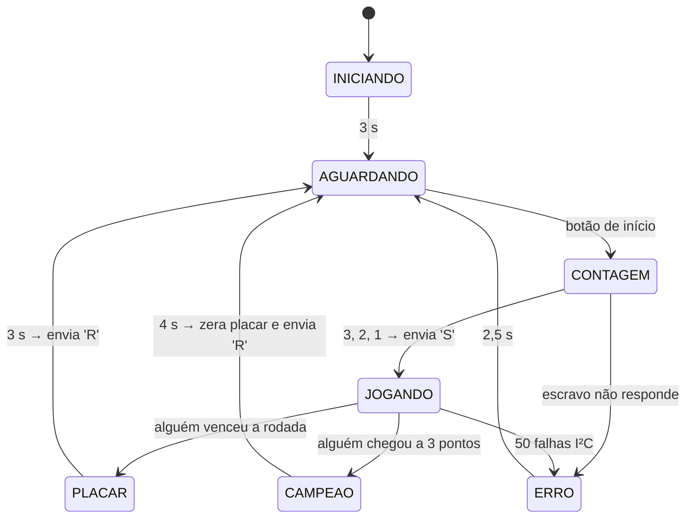
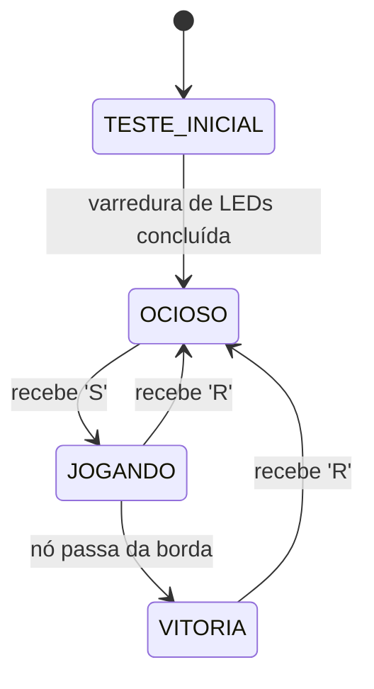
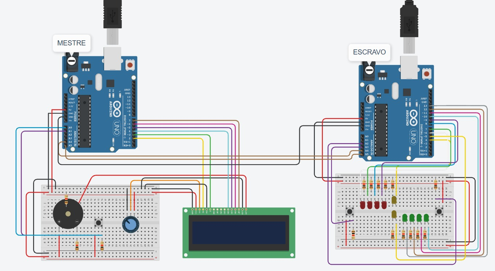

<div align="center">

# 🪢 Cabo de Guerra Embarcado

**Dois Arduinos, uma disputa em tempo real.**
Jogo de cabo de guerra eletrônico com arquitetura **Mestre / Escravo** comunicando-se via barramento **I²C**.


[▶ Ver simulação no Tinkercad](https://www.tinkercad.com/things/7f899RXqTyR-cabo-de-guerra-teste-final?sharecode=5-Rp4g6r7KzbsQoBD7teGLWZ__7-jsutL-vgvJiotwY) · [📄 Apresentação do projeto (PDF)](Cabo-de-Guerra-Embarcado.pdf)

</div>

---

## 📖 Sobre o projeto

Projeto final da disciplina de **Sistemas Embarcados** (graduação). A ideia é traduzir a dinâmica física de um cabo de guerra para o mundo digital: dois jogadores disputam apertando um botão o mais rápido possível, e cada clique **puxa um nó luminoso** (formado por 2 LEDs vizinhos) para o seu lado da corda de LEDs. Quem levar o nó até a ponta do seu campo vence a rodada, e quem fizer **3 pontos primeiro** é o campeão da partida.

Para dividir bem as responsabilidades, o sistema usa **dois Arduinos Uno**:

| | 🧠 Arduino **Mestre** | ⚡ Arduino **Escravo** |
|---|---|---|
| **Papel** | Gestão da partida e interface com o usuário | Mecânica do jogo e sensores |
| **Controla** | Estados do jogo, contagem regressiva, placar | Leitura dos botões e corda de LEDs |
| **Periféricos** | Display LCD 16x2, botão de início, buzzer | 10 LEDs e 2 botões dos jogadores |
| **Arquivo** | [`mestre.ino`](mestre.ino) | [`slave.ino`](slave.ino) |

> 💡 **Por que separar?** Atualizar o LCD e tocar sons são tarefas lentas. Ao isolar a leitura dos botões e o controle dos LEDs em outro microcontrolador, nenhum clique é perdido enquanto o display está sendo escrito.

---

## 🎮 Como jogar

1. Ligue o sistema. O LCD mostra **"Cabo de Guerra / Iniciando..."** enquanto a corda de LEDs faz um **teste de varredura**.
2. Quando o LCD exibir o placar e **"Aperte p/ jogar"**, pressione o **botão de início** (no painel do mestre).
3. O buzzer faz a contagem **3 … 2 … 1** e o LCD mostra **"JÁ!"** → **"LUTEM!!!"**.
4. Cada jogador **clica repetidamente** no seu botão para puxar o nó para o seu lado:
   - **Jogador 1** puxa para a **esquerda** (LEDs vermelhos 🔴)
   - **Jogador 2** puxa para a **direita** (LEDs verdes 🟢)
5. Ao levar o nó além da última casa do seu campo, o jogador **vence a rodada**: os LEDs do seu lado piscam, o buzzer toca uma fanfarra e o placar é atualizado.
6. O primeiro a chegar a **3 pontos** é declarado **campeão** 🏆. Depois de alguns segundos, o placar zera e um novo jogo começa.

### Corda de LEDs

```
 ←  Jogador 1 (-1)                                     Jogador 2 (+1)  →

   🔴  🔴  🔴  🔴  🟡  🟡  🟢  🟢  🟢  🟢
   [0] [1] [2] [3] [4] [5] [6] [7] [8] [9]
                    └───┘
              nó (2 LEDs) começa no centro
```

- O nó ocupa **2 LEDs vizinhos** e começa no centro (LEDs amarelos).
- Cada clique válido desloca o nó em **1 posição**.
- Cliques simultâneos praticamente se anulam e o nó fica parado.
- São necessárias **5 puxadas seguidas** de vantagem para levar o nó até a borda.

---

## 🏗️ Arquitetura

```
        ┌──────────────────────────┐                 ┌──────────────────────────┐
        │      ARDUINO MESTRE      │                 │      ARDUINO ESCRAVO     │
        │       (endereço —)       │                 │     (endereço I²C = 8)   │
        │                          │   SDA (A4) ───► │                          │
        │  • LCD 16x2              │   SCL (A5) ───► │  • 10 LEDs (corda)       │
        │  • Buzzer                │   GND  ◄──────► │  • Botão Jogador 1       │
        │  • Botão de início       │                 │  • Botão Jogador 2       │
        │  • Máquina de estados    │                 │  • Lógica da disputa     │
        └──────────────────────────┘                 └──────────────────────────┘
```

### Protocolo I²C

A comunicação segue um modelo de **comandos + polling**:

| Direção | Dado | Significado |
|---|---|---|
| Mestre → Escravo | `'S'` | **Start** — inicia a rodada |
| Mestre → Escravo | `'R'` | **Reset** — centraliza o nó e volta ao estado ocioso |
| Escravo → Mestre | `0` | Disputa em andamento |
| Escravo → Mestre | `1` | **Jogador 1** venceu a rodada |
| Escravo → Mestre | `2` | **Jogador 2** venceu a rodada |

Durante o combate, o mestre consulta o escravo a cada **20 ms (50 Hz)**: resposta imediata no display sem saturar o barramento. Se o escravo ficar sem responder por **50 consultas seguidas**, o mestre exibe `Erro: Escravo sem resposta` e volta ao menu.

### Fluxo de uma rodada

1. **Contagem** — o mestre faz o 3, 2, 1 sonoro e envia `'S'` ao escravo.
2. **Combate** — o mestre consulta o escravo a cada 20 ms.
3. **Telemetria** — o escravo retorna o byte com o eventual vencedor.
4. **Desfecho** — o mestre toca a fanfarra, atualiza o placar e envia `'R'`.

### Máquinas de estados

**Mestre**



**Escravo**



---

## 🔌 Hardware

### Lista de componentes

| Qtd. | Componente |
|:---:|---|
| 2 | Arduino Uno |
| 1 | Display LCD 16x2 (HD44780) |
| 1 | Potenciômetro (ajuste de contraste do LCD) |
| 1 | Buzzer piezoelétrico |
| 3 | Botões táteis (1 início + 2 jogadores) |
| 4 | LEDs vermelhos |
| 2 | LEDs amarelos |
| 4 | LEDs verdes |
| — | Resistores (limitadores dos LEDs e *pull-down* dos botões) |
| 2 | Protoboards |
| — | Jumpers |

### Pinagem — Mestre

| Pino | Função |
|:---:|---|
| `2` `3` `4` `5` `6` `7` | LCD: `RS`, `E`, `D4`, `D5`, `D6`, `D7` |
| `A0` | Botão de início |
| `A1` | Buzzer |
| `A4` (SDA) / `A5` (SCL) | Barramento I²C |

### Pinagem — Escravo

| Pino | Função |
|:---:|---|
| `6` `7` `8` `9` | LEDs vermelhos (lado do Jogador 1) |
| `4` `5` | LEDs amarelos (centro) |
| `13` `12` `11` `10` | LEDs verdes (lado do Jogador 2) |
| `A3` | Botão do Jogador 1 |
| `A2` | Botão do Jogador 2 |
| `A4` (SDA) / `A5` (SCL) | Barramento I²C |

### Interconexão

Os dois Arduinos precisam de:
- **GND em comum**
- `A4` do mestre ↔ `A4` do escravo (**SDA**)
- `A5` do mestre ↔ `A5` do escravo (**SCL**)

### Esquemático



> Painel do **Mestre** à esquerda e arena do **Escravo** à direita.

---

## 🚀 Como executar

### Opção 1 — Simulação (sem hardware)

Abra o projeto direto no **Tinkercad Circuits**, clique em **Iniciar simulação** e use os botões virtuais:

👉 [Cabo de Guerra — teste final](https://www.tinkercad.com/things/7f899RXqTyR-cabo-de-guerra-teste-final?sharecode=5-Rp4g6r7KzbsQoBD7teGLWZ__7-jsutL-vgvJiotwY)

### Opção 2 — Hardware real

1. Monte o circuito conforme a imagem e as tabelas de pinagem acima.
2. Instale a [Arduino IDE](https://www.arduino.cc/en/software). As bibliotecas `Wire` e `LiquidCrystal` já vêm incluídas.
3. Clone o repositório:
   ```bash
   git clone https://github.com/Davi-Lorena/Sistemas-Embarcados.git
   ```
4. A IDE exige que cada sketch fique em uma pasta com o mesmo nome do arquivo. Organize assim:
   ```
   mestre/mestre.ino
   slave/slave.ino
   ```
5. Conecte **um Arduino por vez**, selecione a placa (*Arduino Uno*) e a porta, e faça o upload:
   - `mestre.ino` → Arduino do **mestre**
   - `slave.ino` → Arduino do **escravo**
6. Ligue o GND dos dois e o SDA/SCL, alimente o conjunto e jogue!

---

## ⚙️ Parâmetros ajustáveis

Constantes no topo de cada arquivo permitem calibrar o jogo sem mexer na lógica:

| Constante | Arquivo | Padrão | Descrição |
|---|---|:---:|---|
| `PONTOS_PARA_VENCER` | `mestre.ino` | `3` | Pontos necessários para ser campeão |
| `CONTAGEM_PASSO_MS` | `mestre.ino` | `1000` | Duração de cada número da contagem regressiva |
| `POLL_MS` | `mestre.ino` | `20` | Intervalo de consulta I²C durante o combate |
| `PLACAR_MS` / `CAMPEAO_MS` | `mestre.ino` | `3000` / `4000` | Tempo de exibição do placar / tela do campeão |
| `FALHAS_I2C_MAX` | `mestre.ino` | `50` | Falhas seguidas até acusar erro |
| `DEBOUNCE_MS` | ambos | `30` | Filtro anti-ruído (*debounce*) dos botões |
| `NUM_LEDS` / `LEDS_POR_LADO` | `slave.ino` | `10` / `4` | Tamanho da corda e do campo de cada jogador |
| `ENDERECO_I2C` | `slave.ino` | `8` | Endereço do escravo (deve bater com `ENDERECO_ESCRAVO` no mestre) |
| `BOTAO_ATIVO_ALTO` | ambos | `true` | `false` para botões com `INPUT_PULLUP` |

---

## 🧩 Conceitos de Sistemas Embarcados aplicados

- **Comunicação serial síncrona I²C** em topologia mestre/escravo (`Wire`: `onReceive`, `onRequest`, `requestFrom`)
- **Máquinas de estados finitos** em ambos os microcontroladores
- **Programação não bloqueante** com `millis()` (sem `delay` no fluxo principal)
- **Debounce por software** encapsulado em classes (`BotaoInicio`, `Jogador`)
- **Tratamento de interrupções**: variáveis `volatile` e seções críticas com `noInterrupts()` / `interrupts()`
- **Tolerância a falhas**: *timeout* do `Wire` e detecção de escravo sem resposta
- **Interface com periféricos**: LCD 16x2 (com caractere customizado para o "ã"), buzzer com `tone()` e LEDs

---

## 📁 Estrutura do repositório

```
Sistemas-Embarcados/
├── mestre.ino                    # Firmware do Arduino mestre (LCD, buzzer, fluxo do jogo)
├── slave.ino                     # Firmware do Arduino escravo (botões e corda de LEDs)
├── circuito.jpeg                 # Esquema de ligação (Tinkercad)
├── Cabo-de-Guerra-Embarcado.pdf  # Apresentação do projeto
└── README.md
```

---

## 👥 Equipe

<!-- Preencha com os integrantes do grupo -->

| Nome | GitHub |
|---|---|
| Davi Lorena | [@Davi-Lorena](https://github.com/Davi-Lorena) |
| Diego Nadur | [@diegonadurcrv-ux](https://github.com/diegonadurcrv-ux) |
| Theo Fellipe | [@TheoFellipe](https://github.com/TheoFellipe) |

**Disciplina:** Sistemas Embarcados
**Curso:** _Nome do curso_ — _Nome da universidade_
**Professor(a):** _Nome do(a) professor(a)_
**Semestre:** _2026.2_

---
